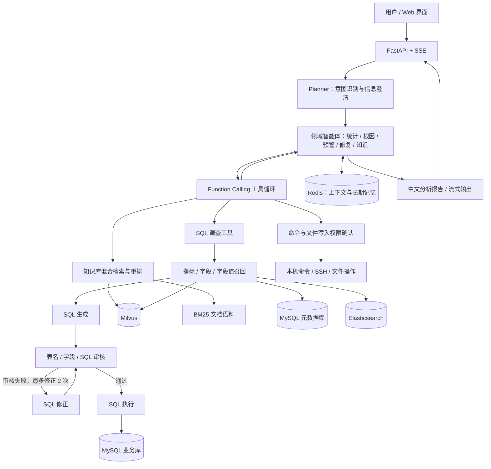

<div align="center">

# AIOps · SQL Insight

**面向 IT 运维的多智能体助手：自然语言查询、故障调查、知识检索与修复执行**


[快速开始](#快速开始) · [系统架构](#系统架构) · [知识库流水线](#知识库流水线) · [接口说明](#接口说明) · [开发与测试](#开发与测试)

</div>

## 项目介绍

AIOps 将运维数据库、故障知识库和执行工具接入同一个对话界面。用户提出问题后，规划智能体识别任务，领域智能体通过工具获取数据和证据，最后生成中文分析报告。需要修改文件或执行命令时，系统按照当前权限模式进入确认流程。

仓库包含两个主要模块：

- **`it_agent/`：在线运维应用。** FastAPI 提供 API 和单页 Web 界面，支持 SQL 调查、知识检索、本机与 SSH 操作、会话记忆和流式回答。
- **`handle/`：知识库离线流水线。** 完成文档生成、解析、分块、向量化、混合检索、重排和 RAG 评估，为知识检索提供语料与索引。

适合探索多智能体编排、Text-to-SQL、检索增强生成，以及需要人工确认的运维工具调用场景。

## 核心能力

| 能力 | 实现方式 |
| --- | --- |
| 统计分析 | 根据自然语言生成 SQL，查询资产、指标、告警等数据，输出表格和统计报告 |
| 根因分析 | 多轮调用调查工具，结合指标、告警和资源关系组织故障证据 |
| 趋势预警 | 根据查询到的历史与当前数据分析风险，生成预防和容量建议 |
| 智能修复 | 调用本机命令、SSH 和文件工具，按权限模式确认执行 |
| 知识管理 | 向量检索与 BM25 召回，经 RRF 融合和重排获取案例、经验和 SOP |
| SQL 语义召回 | 召回指标、字段及真实字段值，补齐相关表结构和业务语义 |
| 流式交互 | SSE 展示规划、工具执行和回答过程，支持取消、检查点继续与中断续写 |
| 上下文与记忆 | Redis 会话记忆、长期记忆检索，以及大结果归档和历史压缩 |
| 技能扩展 | 从 `SKILL.md` 发现技能，提供列表、详情和渐进式加载 |
| 可观测性 | JSON 运行日志、对话轨迹、压缩记录与 LLM 调用级数据采集 |

### 使用示例

| 场景 | 示例问题 |
| --- | --- |
| 资产统计 | 当前监控了多少台服务器？按资源类型统计数量。 |
| 资源巡检 | 根据最新指标，生成资源巡检报告。 |
| 告警调查 | 哪些设备存在紧急告警？分别关联了什么指标？ |
| 根因分析 | 某台主机 CPU 持续偏高，请结合指标与告警分析原因。 |
| 知识检索 | Linux 进程频繁进入 D 状态有哪些常见原因和排查步骤？ |
| 远程诊断 | 检查指定主机的磁盘空间，并说明下一步处理建议。 |

查询结果取决于接入的数据库和知识库；远程诊断需要配置目标主机的 SSH 凭据。

## 系统架构



**调查与决策分工：** 外层领域智能体决定需要哪些证据、是否继续调查；SQL 调查工具每次完成选表、生成、审核、修正和执行，并返回结构化结果。调用次数由外层工具循环控制。

**两类检索索引：** SQL 召回使用 `sql_column_recall`、`sql_metric_recall` 和 `sql_value_recall`；文档 RAG 使用 `aiops_knowledge` 和本地 BM25 语料。两者分别服务于 SQL 生成和知识问答。

## 技术栈

| 层级 | 技术 |
| --- | --- |
| 前端 | HTML、Tailwind CSS、JavaScript、Marked.js、Highlight.js |
| Web 服务 | FastAPI、Uvicorn、sse-starlette |
| 智能体编排 | 自研 `AgentState`、`NodeRouter`、Function Calling 工具循环 |
| 大语言模型 | DashScope / Ollama |
| 数据访问 | MySQL、PyMySQL、DBUtils |
| 记忆与缓存 | Redis |
| 检索与重排 | Milvus、Elasticsearch、jieba、BM25、RRF、Qwen Rerank |
| 远程操作 | Paramiko、凭据解密 |
| 文档与评估 | python-docx、pypdf、BeautifulSoup、Ragas |

## 快速开始

### 1. 准备环境

准备 Python 3.11 或更高版本，以及与项目表结构匹配的 MySQL 数据库。

| 服务 | 当前默认地址 | 用途 |
| --- | --- | --- |
| Web 应用 | `http://127.0.0.1:8005` | 页面与 API |
| MySQL | 由 `.env` 配置，通常端口 `3306` | 业务数据和 SQL 元数据 |
| Redis | `redis://127.0.0.1:6379/0` | 会话与长期记忆 |
| Ollama | `http://localhost:11434` | 本地 LLM 和检索 embedding |
| Milvus | `http://localhost:19530` | SQL 与文档向量索引 |
| Elasticsearch | `localhost:9200` | SQL 字段真实取值召回 |

数据库问答需要可用的 LLM 和业务数据库。完整的 SQL 语义召回还需要元数据库、embedding、Milvus 和 Elasticsearch；文档 RAG 需要知识语料及相应检索服务。Redis 不可用时，记忆功能会降级。

### 2. 获取代码并安装依赖

以下命令在 macOS / Linux 终端执行：

```bash
git clone https://github.com/duyanhedyh/aiops.git
cd aiops/it_agent

python3 -m venv .venv
.venv/bin/python -m pip install -r requirements.txt
cp .env.example .env
```

### 3. 配置数据库和模型

编辑 `it_agent/.env`，使用自己的数据库连接信息和 API Key：

```dotenv
DB_HOST=127.0.0.1
DB_PORT=3306
DB_DATABASE=yunwei
DB_USERNAME=your_db_user
DB_PASSWORD=your_db_password
DB_CHARSET=utf8mb4

LLM_PROVIDER=dashscope
DASHSCOPE_API_KEY=your_dashscope_api_key
DASHSCOPE_MODEL=qwen-flash
ENABLE_THINKING=0

MEMORY_CLEANUP_INTERVAL_SECONDS=3600
```

`qwen-flash` 是本项目已验证的低成本配置示例；模型必须支持项目使用的 DashScope 接口及工具调用。环境变量优先于 `.env`，修改配置后需要重启 Web 服务。

如果使用本地 Ollama，将模型配置改为：

```dotenv
LLM_PROVIDER=ollama
OLLAMA_BASE_URL=http://localhost:11434
OLLAMA_MODEL=qwen3:8b
```

本地模型需要支持工具调用，并提前拉取模型。知识库和 SQL 召回默认使用 `nomic-embed-text` 做 embedding；它与对话模型分别配置。

**数据库准备：** 表结构与语义说明见 [IT 监控系统数据表说明](IT监控系统数据表说明文档.md)、[数据库重构说明](重构数据库介绍.md) 和 [SQL 元数据配置](it_agent/backend/sql/schema_meta.yaml)。[测试种子数据](docs/data/seed_data_realistic_20260731.sql)包含建表与样例数据，也包含 `DROP TABLE IF EXISTS`，仅适合核对后用于隔离测试库。已有数据库应按需要检查 [数据与迁移脚本](docs/data/)，避免直接覆盖业务表。

**迁移到新环境：** `backend/config.py` 中的 Redis 地址、Milvus 地址、ES 地址、元数据库名、权限默认模式和 `RAG_CORPUS` 当前为代码配置。尤其要将 `RAG_CORPUS` 调整为自己仓库中 `handle/stage3_chunk/method4_h3_chunk/output/all_chunks.jsonl` 的实际路径。仅在 `.env` 添加同名变量不会覆盖这些常量。

远程操作还需要设置 `JWT_SECRET_KEY`，与保存 SSH 凭据时使用的密钥一致。

### 4. 启动应用

在 `it_agent/` 目录执行：

```bash
.venv/bin/python -m uvicorn backend.app:app \
  --host 127.0.0.1 --port 8005
```

打开 [http://localhost:8005](http://localhost:8005)，选择领域智能体后输入问题。按 `Ctrl+C` 停止服务。

Windows 对应命令：

```powershell
python -m venv .venv
.venv\Scripts\python.exe -m pip install -r requirements.txt
Copy-Item .env.example .env
# 编辑 .env 后启动
.venv\Scripts\python.exe -m uvicorn backend.app:app --host 127.0.0.1 --port 8005
```

仓库也提供 `start.sh` 和 `start.bat`。这些脚本会安装依赖，并结束占用 8005 端口的进程；使用前应确认该端口由本项目占用。

### 5. 验证运行状态

```bash
curl -f http://127.0.0.1:8005/
curl -f http://127.0.0.1:8005/api/skills
curl -f 'http://127.0.0.1:8005/api/alerts?limit=1'
```

`/api/alerts` 响应中的 `ok: true` 表示告警和设备概览查询成功。数据库查询失败时，该接口仍可能返回 HTTP 200，请同时检查 JSON 中的 `ok` 与 `error`。

## 权限与执行

命令执行和文件写入支持三种模式，当前默认 `manual`：

| 模式 | 行为 |
| --- | --- |
| `manual` | 操作等待用户确认后执行 |
| `auto` | 低风险操作可直接执行，高风险操作等待人工确认 |
| `unrestricted` | 直接执行操作 |

命令风险判断采用规则与 LLM 复核；批准流程核对待执行工具及参数。SQL 审核包含表名、字段和写入关键词检查，数据库权限仍应按实际需求配置。文件读取、命令执行与 SSH 工具作用于应用运行环境，应在受控环境中使用。

当前应用入口未实现用户登录鉴权，默认按本地开发方式部署；公开服务需要补充访问控制。日志和 LLM 轨迹可能包含问题、SQL、查询结果与工具输出，提交仓库前应检查这些内容，并保管好 `.env` 与远程凭据。

## 知识库流水线

`handle/` 为知识库提供七阶段处理流程：


| 阶段 | 工作内容 | 文档 |
| --- | --- | --- |
| 1 | 从主题生成 DOCX、HTML、Markdown、PDF 等知识文档 | [文档生成](handle/stage1_generate/README.md) |
| 2 | 多格式解析与结构化块提取 | [文档解析](handle/stage2_parse/README.md) |
| 3 | LangChain 分块与按 H3 分块两种方案 | [文档分块](handle/stage3_chunk/README.md) |
| 4 | embedding 生成与 Milvus 入库 | [向量化](handle/stage4_vectorize/README.md) |
| 5 | 向量与 BM25 召回，RRF 融合 | [混合检索](handle/stage5_retrieval/README.md) |
| 6 | Qwen Rerank 二次排序 | [重排](handle/stage6_rerank/README.md) |
| 7 | 生成回答并通过 Ragas 评估 | [评估](handle/stage7_eval/README.md) |

在仓库根目录创建流水线的独立环境：

```bash
cd handle
python3 -m venv .venv
.venv/bin/python -m pip install -r requirements.txt

# 将现有分块向量化，写入 Milvus
bash stage4_vectorize/run_vectorize.sh

# 检索并重排
bash stage6_rerank/run_rerank.sh "Linux服务器CPU使用率持续超过90%如何定位" \
  --top-k 5 --candidate-k 20

# 小批量评估
bash stage7_eval/run_eval.sh --limit 5
```

运行前按各阶段文档配置模型凭据、语料路径、embedding 和 Milvus 服务。文档生成、云端重排、回答生成及评估可能调用计费 API。已有评估产物不代表完整测试集已评测完成，结果应以本次运行的样本范围为准。

### 构建 SQL 召回索引

SQL 召回元数据由 `schema_meta.yaml` 定义，离线构建时会写入 MySQL 元数据库、Milvus 集合和 Elasticsearch 索引。在 `it_agent/` 目录执行：

```bash
.venv/bin/python -m backend.sql.recall.build_meta \
  --conf backend/sql/schema_meta.yaml
```

该命令需要相应服务可用，并具备元数据建表及索引写入权限。详细流程见 [SQL 语义召回说明](it_agent/backend/sql/recall/README.md)。

## 项目结构

```text
aiops/
├── README.md                       # 仓库介绍与运行指南
├── it_agent/                       # 在线运维应用
│   ├── backend/
│   │   ├── app.py                  # FastAPI 入口与 SSE 接口
│   │   ├── agent.py                # 多智能体编排
│   │   ├── agent_state.py          # 共享状态与节点路由
│   │   ├── agents/                 # 规划、领域智能体及 SQL 工作流
│   │   ├── sql/                    # 业务语义、数据库访问与 SQL 召回
│   │   ├── knowledge_rag/          # 在线知识库混合检索
│   │   ├── tools/                  # SQL、SSH、命令与文件工具
│   │   ├── services/               # 记忆、压缩、权限和语音服务
│   │   ├── dashboard/              # 告警与资源概览
│   │   ├── skills/                 # 技能发现与加载
│   │   ├── config.py               # 环境与服务配置
│   │   └── llm_client.py           # LLM 调用适配
│   ├── frontend/                   # 单页 Web 界面与前端资源
│   ├── skills/                     # SKILL.md 技能目录
│   ├── tests/                      # 应用测试
│   ├── logs/                       # 运行日志与 LLM 轨迹
│   ├── .env.example                # 环境变量示例
│   ├── requirements.txt
│   └── Dockerfile
├── docs/data/                      # 测试数据与数据库迁移脚本
└── volumes/                        # 本地外部服务的数据目录
```

## 接口说明

启动后可访问 [Swagger UI](http://localhost:8005/docs) 查看请求参数和数据结构。

| 方法 | 路径 | 说明 |
| --- | --- | --- |
| `GET` | `/` | Web 页面 |
| `GET` | `/api/chat` | SSE 对话；参数包括 `q`、`session`、`agent`、`perm_mode` |
| `POST` | `/api/chat/resume` | 根据问题和部分回答继续生成 |
| `POST` | `/api/chat/continue` | 从服务端检查点继续执行 |
| `POST` | `/api/chat/approve` | 批准或拒绝待执行操作 |
| `POST` | `/api/chat/approve/resume` | 确认操作后恢复 SSE |
| `POST` | `/api/cancel` | 取消当前会话请求 |
| `POST` | `/api/reset` | 重置会话 |
| `POST` | `/api/chat/summarize` | 汇总会话并写入记忆 |
| `GET` | `/api/alerts` | 告警列表与设备概览 |
| `GET` | `/api/skills` | 技能元数据列表 |
| `GET` | `/api/skills/{name}` | 技能详情 |
| `POST` | `/api/asr` | 上传音频并识别文本 |

SSE 调用示例：

```bash
curl -N -G 'http://127.0.0.1:8005/api/chat' \
  --data-urlencode 'q=当前监控了多少台服务器？' \
  --data-urlencode 'agent=analytics' \
  --data-urlencode 'session=demo' \
  --data-urlencode 'perm_mode=manual'
```

`agent` 可选 `analytics`、`warning`、`rootcause`、`repair`、`knowledge`。应用通过 `session` 区分会话；进程内的智能体实例和执行检查点会在服务重启后丢失。

## 开发与测试

在 `it_agent/` 目录运行：

```bash
# TestClient 所需的测试依赖
.venv/bin/python -m pip install httpx

# 应用测试
.venv/bin/python -m pytest tests -q

# LLM 接口和连接重试测试
.venv/bin/python -m pytest \
  tests/test_tool_llm_client.py tests/test_dashscope_connection_retry.py -q
```

测试覆盖路由、SQL 工作流、工具调用、权限确认、记忆、检索、前端问题与日志轨迹。部分用例依赖真实数据库表结构，需要配置匹配的数据环境；测试通过与否不代表线上模型回答的准确率。

应用日志位于 `it_agent/logs/logger/`，对话和模型调用轨迹位于 `it_agent/logs/llm_trace/`。扩展工具可参考 `backend/tools/registry.py`，扩展技能可参考 `skills/` 与 `backend/skills/registry.py`。

## 常见问题

<details>
<summary>页面能打开，但没有告警或设备数据</summary>

检查 MySQL 服务是否启动，`.env` 的连接参数是否正确，以及业务库是否具有匹配的表结构。查看 `/api/alerts` 的 `ok` 和 `error` 字段定位失败原因。

</details>

<details>
<summary>DashScope 出现连接错误、401 或 url error</summary>

连接错误应检查网络、代理和证书；客户端对收到响应前的连接失败有有限重试。401 应核对 API Key、所属地域及环境变量覆盖。`url error` 可能表示模型与 API 路径不匹配：当前对话客户端使用 `Generation.call`，更换模型时需要确认接口兼容性。

</details>

<details>
<summary>知识库没有检索结果</summary>

先检查 `RAG_CORPUS` 文件是否存在，再核对 Ollama embedding 模型、Milvus 集合和向量维度。向量路异常可退化为 BM25；重排异常会保留融合后的候选。没有可用语料和索引时，检索无法提供有效证据。

</details>

<details>
<summary>修改 .env 后没有生效</summary>

配置在模块加载时读取，需要重启服务。进程环境变量会覆盖 `.env`；Redis、Milvus、ES、语料路径等代码常量需要在 `backend/config.py` 中调整。

</details>

<details>
<summary>语音识别不可用</summary>

语音服务使用 DashScope，独立于对话模型后端，需有效 API Key 和 `ffmpeg`。当前实际 ASR 模型由 `backend/config.py` 中的 `ASR_MODEL` 常量指定。

</details>

## 进一步阅读

- [应用说明](it_agent/README.md)
- [知识库流水线说明](handle/README.md)
- [SQL 召回与元数据说明](it_agent/backend/sql/recall/README.md)
- [项目介绍](it_agent_项目介绍.md)

本文以当前代码结构与启动方式为准；子模块文档中的历史目录、路径或配置可能需要按实际环境调整。
